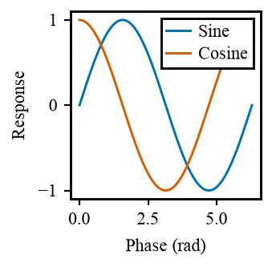
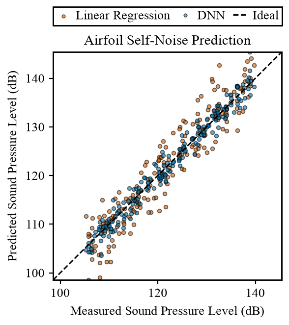
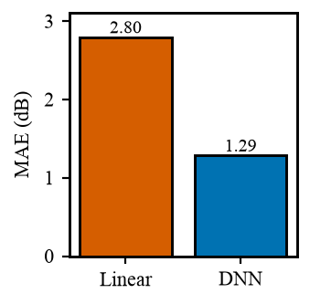
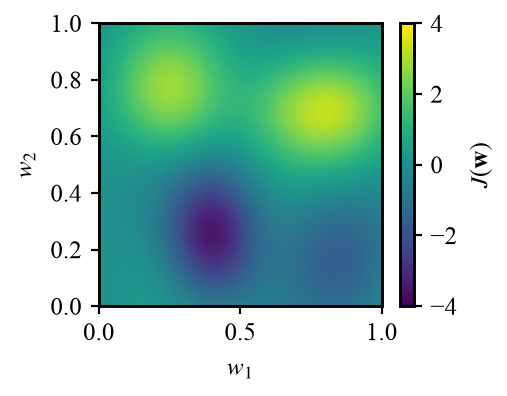
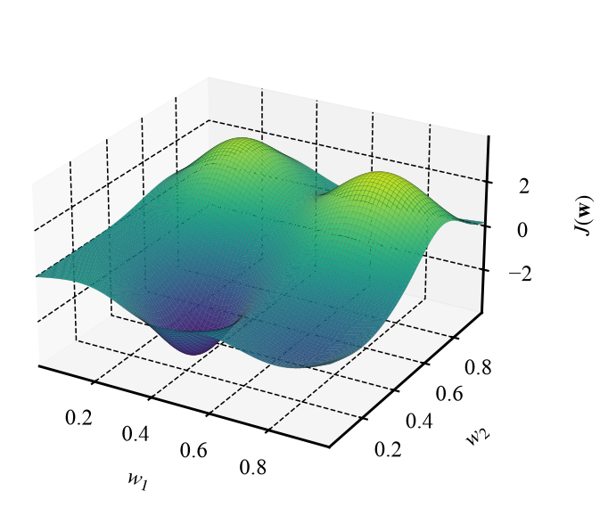
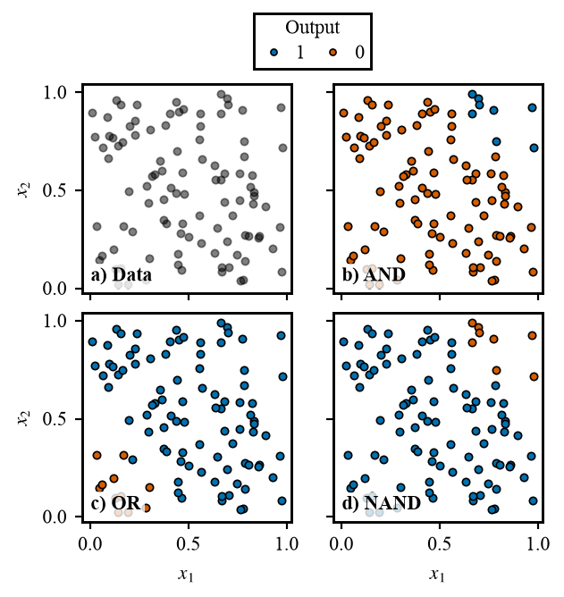
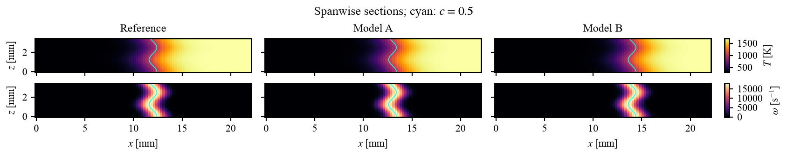

# Plot gallery

These figures come from the [plotting tutorial](../tutorials/plots.ipynb). The examples draw with Matplotlib and finish with Hedgehogs.

## Lines and prediction errors

## Fields and surfaces

## Panel grids

For colour choices, see [built-in palettes](api/palettes.md#built-in-palettes).
